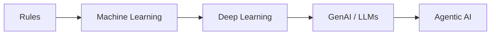
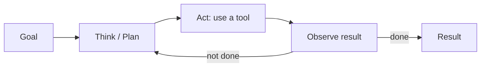
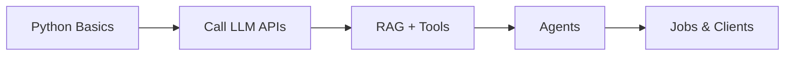

# Lesson 1.1: Welcome to the GenAI & Agentic AI

**Course:** Python for AI . **Module 1:** Python Basics for GenAI and Agentic AI . **Updated:** Oct 2026

> **By the end:** You can explain AI, GenAI and Agentic AI in one line each, know why Python is the language of applied AI, and see where the jobs and client work are.

---

## 1. What is AI?

**One line:** AI is software that *learns patterns from huge amounts of data* instead of following only hand-written rules.

| Type | How it works | Example |
|---|---|---|
| Traditional code | You write every rule | Rule-based chatbot |
| Machine Learning | Learns patterns from data | Spam filter |
| **Generative AI** | Creates new text, code, images | ChatGPT, Claude, Gemini |
| **Agentic AI** | Plans + uses tools + acts to finish a goal | Claude Code, Codex, coding and support agents |



---

## 2. GenAI in 60 seconds

**Mental model:** An LLM is a *super-autocomplete*. It predicts the next word (token) very, very well.

**5 words you must know:**
- **Prompt:** your instruction to the model
- **Token:** a piece of a word (you pay per token)
- **Model:** the trained brain (Claude, Qwen, Kimi, GPT, GLM, Gemini, Grok)
- **Context window:** how much the model can "see" at once
- **Hallucination:** a confident but wrong answer, so always verify

---

## 3. Agentic AI: the big shift

**Mental model:** **Agent = LLM + Tools + Memory + Loop**

A chatbot *answers*. An agent *does the work*.



| Chatbot | Agent |
|---|---|
| "Here's how to book a flight" | Searches, compares, fills the form, asks you to confirm |
| One reply | Many steps until the goal is done |

---

## 4. What is Python?

A simple, readable programming language that reads almost like English.

```python
model = "qwen"
print(f"Hello from {model}!")
```

---

## 5. Why Python for GenAI & Agentic AI?

- **AI SDKs are Python-first:** Ollama, Anthropic, OpenAI, Google GenAI
- **Agent frameworks live in Python:** LangChain / LangGraph, LlamaIndex, CrewAI, OpenAI Agents SDK, Claude Agent SDK, MCP servers
- **Easy to learn:** beginners build real apps in weeks
- **Glue language:** connects APIs, files, databases, websites

### Why not start with ML / DL?

**Mental model:** *Don't build the engine, learn to drive the car.*

- Big companies already trained the models; most businesses **use** them through APIs
- Training models is expensive, math-heavy, specialist work
- Industry demand today is **Applied AI**: connecting models to real business problems
- ML / DL is still valuable. Learn it **later**, when you need it

---

## 6. Jobs & Earning Map

| Role | What you do |
|---|---|
| AI Engineer / Applied AI Engineer | Build apps on top of LLMs |
| AI Agent Developer | Build agents that use tools and APIs |
| AI Automation Specialist | Automate email, docs, CRM, WhatsApp workflows |
| Python Developer (AI-skilled) | Normal dev work, 2x faster with AI tools |

**Top freelance / client gigs (beginner to pro):**
1. Business chatbot (website / WhatsApp)
2. "Chat with your documents" (PDFs, policies) using RAG
3. Data extraction (invoices, CVs to Excel)
4. Workflow automation (emails, reports, lead follow-up)
5. Custom AI agents for small businesses



---

## 7. Client-Ready Mindset

Clients pay for **outcomes**, not code. Sell "save 10 hours/week", not "I used Python".

**Always ask a client 3 questions:**
1. What task wastes the most time?
2. What does success look like (as a number)?
3. Where does the data live?

**Build your proof from Day 1:** push every lesson to GitHub and it becomes your portfolio.

---

## 8. Case Studies (real world)

- **Klarna (2024-25):** its AI assistant took over a large share of customer chats; later the company brought human support back for complex cases. **Lesson:** best results come from AI + human.
- **Coding agents (Claude Code, Codex, GitHub Copilot):** developers now hand off whole tasks to agents. **Lesson:** devs who use AI well are the ones getting hired.
- **Local models (Ollama):** run AI free and private on your laptop. Great for clients with sensitive data.

---

## 9. Your Task (self-create)

1. In `code/`, create `lesson_01_intro.py`
2. Print your name, your dream AI role, and one business problem AI could solve
3. Run: `cd code`, then `uv run lesson_01_intro.py`
4. Commit and push to your `python-ai` GitHub repo

---

## 10. Key Takeaways

- **AI** learns from data · **GenAI** creates · **Agentic AI** acts
- **Agent = LLM + Tools + Memory + Loop**
- **Python** is the language of applied AI
- Industry pays for **using** models well, not training them
- Start your **GitHub portfolio today**

### Quick Check
1. Chatbot vs Agent: what is the difference in one line?
2. Why start with GenAI instead of ML/DL?
3. Name one AI gig you could sell to a local business.

---

## Must-Have Resources

- Python: https://www.python.org
- uv docs: https://docs.astral.sh/uv
- Anthropic docs: https://docs.claude.com
- Building effective agents (Anthropic): https://www.anthropic.com/engineering/building-effective-agents
- Model Context Protocol: https://modelcontextprotocol.io
- Ollama: https://ollama.com
- DeepLearning.AI short courses: https://www.deeplearning.ai/short-courses

**Next:** Lesson 1.2: Setting Up Your AI Dev Toolkit
