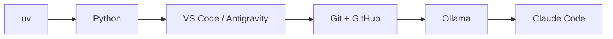

# Lesson 1.2: Setting Up Your AI Dev Toolkit

**Course:** Python for AI · **Module 1:** Python Basics for GenAI and Agentic AI · **Updated:** Oct 2026

> **By the end:** Your laptop has the same toolkit professional AI engineers use, and every tool passes a version check.

---

## 1. The Toolkit at a Glance

**Mental model:** *A chef needs a kitchen before cooking.* Set it up once, use it for your whole career.

| Tool | Job | Industry use |
|---|---|---|
| **Python** | The language | Every AI SDK and agent framework |
| **uv** | Installs Python + packages, manages projects | Fast, modern standard |
| **VS Code / Antigravity** | Where you write code | Daily editor for most AI devs |
| **Git + GitHub** | Save versions, share code | Portfolio + team work |
| **Ollama** | Run AI models free on your laptop | Private / offline AI for clients |
| **Claude Code** | AI coding agent in your terminal | How modern devs ship faster |



---

## 2. Package Managers: pip vs Poetry vs uv

| | pip | Poetry | **uv** |
|---|---|---|---|
| Speed | Slow | Medium | **Very fast** |
| Installs Python itself | No | No | **Yes** |
| Virtual envs + lock file | Manual | Yes | **Yes, automatic** |
| Our choice | | | **Yes** |

**Mental model:** pip = a single tool. uv = the whole toolbox in one command.

---

## 3. Install uv

**macOS / Linux**
```bash
curl -LsSf https://astral.sh/uv/install.sh | sh
```

**Windows (PowerShell)**
```powershell
powershell -ExecutionPolicy ByPass -c "irm https://astral.sh/uv/install.ps1 | iex"
```

**Windows PATH (only if `uv` is not found):**
1. Close and reopen the terminal first (fixes it most of the time)
2. Still failing? Search "Environment Variables" > Path > add `C:\Users\<you>\.local\bin`

**Check + update**
```bash
uv --version
uv self update
```
Expected: `uv 0.13.0 ...`

---

## 4. Install Python with uv

```bash
uv python install                 # latest version
uv python install 3.12 3.13 3.14  # specific versions
uv python install 3.13.16         # exact version (our course)
uv run python --version           # Python 3.13.16
```

**Option B:** official installer from https://www.python.org (Windows 64-bit installer, tick "Add python.exe to PATH").

**Why 3.13 and not the newest?** AI libraries need time to support new versions. Pros use a *stable* version, not the *latest*.

---

## 5. Install Your Editor

- **VS Code:** https://code.visualstudio.com, then install the **Python** extension
- **Antigravity (Google's agent-first IDE):** https://antigravity.google

```bash
code --version   # 1.139.1
agy --version    # 1.3.2
```

---

## 6. Git + GitHub

1. Create an account at https://github.com (use an email you will keep)
2. Install Git from https://git-scm.com
3. Create a repo named `python-ai`

```bash
git --version   # git version 2.56.0
git config --global user.name "Your Name"
git config --global user.email "your.email@example.com"
```

**Rule:** use the **same email** as your GitHub account so commits count on your profile.

---

## 7. Ollama (local AI models)

Download: https://ollama.com/download

```bash
ollama --version        # ollama version is 0.40.3
ollama run gemma3:1b     # downloads a small model and opens a chat
ollama run gemma4:31b-cloud
```

Type `/bye` to exit. Start with **small models** (1B to 4B) if your laptop has 8 GB RAM.

---

## 8. Claude Code (AI coding agent)

Install guide: https://docs.claude.com/en/docs/claude-code

```bash
claude --version   # 2.1.296 (Claude Code)
```

Needs a Claude subscription or API account. **Use it to learn, not to skip learning:** ask it to *explain*, then type the code yourself.

---

## 9. Final Health Check

Run all of these. Every line must print a version.

```bash
uv --version
uv run python --version
code --version
git --version
ollama --version
claude --version
```

| Problem | Fix |
|---|---|
| `command not found` | Restart terminal, then check PATH |
| PowerShell blocks script | Use the `-ExecutionPolicy ByPass` command above |
| Ollama very slow | Use a smaller model |
| Git asks for password on push | Sign in through VS Code or use a GitHub token |

---

## 10. Job & Client Angle

- Clean setup = **professional signal**. Clients and teams expect `uv`, Git and a clean repo.
- **Ollama** lets you sell *private AI* to clients who cannot send data to the cloud (clinics, law firms, banks).
- **Claude Code / AI agents** in your workflow = faster delivery = more projects per month.

---

## 11. Your Task (self-create)

1. Pass the full health check in Section 9
2. Take a screenshot of all versions and save it in `docs/`
3. Chat with a model in Ollama and ask: *"Explain Python in 2 lines for a beginner"*
4. Commit and push to your `python-ai` repo

---

## Key Takeaways

- **uv** = one tool for Python, packages and projects
- Use a **stable** Python (3.13), not the newest
- Same email for **Git and GitHub**
- **Ollama** = free, private, local AI
- AI agents help you **learn faster**, not think less

### Quick Check
1. Why do we choose uv over pip?
2. Your terminal says `uv: command not found`. First fix?
3. Name one client who would prefer Ollama over cloud AI.

---

## Must-Have Resources

- uv docs: https://docs.astral.sh/uv
- Python downloads: https://www.python.org/downloads
- VS Code Python setup: https://code.visualstudio.com/docs/python/python-tutorial
- Git basics: https://git-scm.com/book/en/v2
- Ollama model library: https://ollama.com/library
- Claude Code docs: https://docs.claude.com/en/docs/claude-code

**Next:** Lesson 1.3: Your First Python Project with uv
