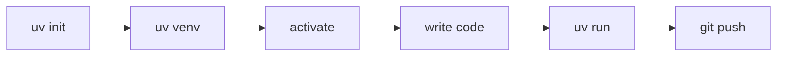

# Lesson 1.3: Your First Python Project with uv

**Course:** Python for AI · **Module 1:** Python Basics for GenAI and Agentic AI · **Updated:** Oct 2026

> **By the end:** You have a clean, professional `python-ai` project, your first script runs, and the code is live on GitHub.

---

## 1. Mental Model: What is a Project?

**A project = a folder + a recipe + a private kitchen + a receipt.**

| Part | File | Meaning |
|---|---|---|
| Recipe | `pyproject.toml` | Project name, Python version, packages needed |
| Private kitchen | `.venv/` | This project's own Python + packages |
| Receipt | `uv.lock` | Exact package versions, so it runs the same on any laptop |
| Version pin | `.python-version` | Which Python this project uses |

**Why it matters:** clients and teams can clone your repo and run it in one command. That is "client-ready".

---

## 2. Create the Project

```bash
cd Desktop
uv init python-ai --python 3.13
cd python-ai
uv venv
```

**Activate the environment**

| OS | Command |
|---|---|
| macOS / Linux | `source .venv/bin/activate` |
| Windows (PowerShell) | `.venv\Scripts\activate` |

You will see `(python-ai)` at the start of your terminal line. Open the project:

```bash
code .
```



---

## 3. Final Project Structure

Create 3 folders: `code`, `notebooks`, `docs`.

```text
python-ai/
├── .venv/              # private Python (never upload)
├── code/               # your .py lesson files
├── notebooks/          # Jupyter notebooks (.ipynb)
├── docs/               # lesson notes (.md)
├── .gitignore          # files Git should ignore
├── .python-version     # 3.13
├── main.py             # first script
├── pyproject.toml      # project recipe
├── uv.lock             # exact versions
└── README.md           # project front page
```

---

## 4. Your First Script

**main.py**
```python
print("Hi there!")
```

```bash
uv run main.py
# Hi there!
```

**Lesson file in `code/`** (create `lesson_01_intro.py` yourself):
```python
name = "Your Name"
goal = "AI Agent Developer"
print(f"Hi, I am {name} and I will become an {goal}.")
```

```bash
cd code
uv run lesson_01_intro.py
```

**Why `uv run`?** It always uses the project's `.venv`, even if you forgot to activate it.

---

## 5. Clean Up: Remove `src/` (Simple Project Mode)

We are building scripts, not a library, so we do not need `src/`.

1. Delete the folder `src/python_ai/`
2. In `pyproject.toml`, remove these lines:

```toml
[project.scripts]
python-ai = "python_ai:main"

[build-system]
requires = ["uv_build>=0.13.0,<0.14.0"]
build-backend = "uv_build"
```

**Your `pyproject.toml` now looks like this:**
```toml
[project]
name = "python-ai"
version = "0.1.0"
description = "Python for AI"
readme = "README.md"
requires-python = ">=3.13"
dependencies = []
```

3. Test again:
```bash
uv run main.py
cd code
uv run lesson_01_intro.py
```

Both must still print. If yes, the cleanup worked.

| Package mode (`src/`) | Simple mode (ours) |
|---|---|
| For libraries others install | For scripts, apps, learning |
| Needs build system | No build system |

---

## 6. Add Packages (preview)

```bash
uv add ollama          # adds a package to the project
uv add --dev ipykernel # lets VS Code run notebooks in notebooks/
uv remove ollama       # removes it
```

`uv add` updates `pyproject.toml` and `uv.lock` automatically. Never install with plain `pip` inside a uv project.

---

## 7. Push to GitHub

`uv init` already started a Git repo for you.

```bash
git add .
git commit -m "Python for AI"
git branch -M main
git remote add origin https://github.com/<your-username>/python-ai.git
git push -u origin main
```

**Check:** `.venv/` must NOT appear on GitHub. The `.gitignore` handles this.

---

## 8. Common Errors

| Error | Fix |
|---|---|
| `No such file or directory` | You are in the wrong folder. Run `pwd` (Mac/Linux) or `cd` (Windows) |
| Activate blocked on Windows | Run `Set-ExecutionPolicy -Scope CurrentUser RemoteSigned` once |
| `remote origin already exists` | `git remote set-url origin <url>` |
| Code changes do not show | Save the file (Ctrl+S / Cmd+S) before running |

---

## 9. Job & Client Angle

- A clean repo with `pyproject.toml` + `uv.lock` + `README.md` is what **recruiters and clients open first**.
- **Reproducible** projects ("clone and run") save clients time and build trust.
- Your `python-ai` repo becomes a **public learning log**: one commit per lesson shows consistency.

---

## 10. Your Task (self-create)

1. Build the structure from Section 3
2. Remove `src/` and the toml lines, then confirm both scripts still run
3. Write 3 lines in `README.md`: who you are, course name, your AI goal
4. Push to GitHub and share your repo link

---

## Key Takeaways

- `pyproject.toml` = recipe · `.venv` = kitchen · `uv.lock` = receipt
- Always run code with **`uv run`**
- Simple projects do **not need `src/`** or a build system
- Add packages with **`uv add`**, never plain pip
- **Push every lesson** to GitHub

### Quick Check
1. What does `uv.lock` guarantee?
2. Why should `.venv` never be uploaded to GitHub?
3. After removing `[build-system]`, how do you prove nothing broke?

---

## Must-Have Resources

- uv projects guide: https://docs.astral.sh/uv/guides/projects
- uv working on projects: https://docs.astral.sh/uv/concepts/projects
- GitHub: create a repo: https://docs.github.com/en/repositories/creating-and-managing-repositories/quickstart-for-repositories
- Writing a good README: https://www.makeareadme.com

**Next:** Lesson 1.4: Talking to Python: print, input and Comments
