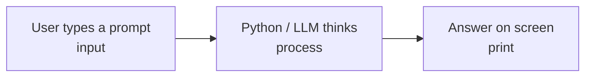

# Lesson 1.4: Talking to Python: print, input and Comments

**Course:** Python for AI · **Module 1:** Python Basics for GenAI and Agentic AI · **Updated:** Oct 2026

> **By the end:** You can show output, take user input, write clean comments, and build the input/output skeleton of every AI chatbot.

---

## 1. Mental Model: Every AI App is Input > Process > Output



| Python | In an AI app |
|---|---|
| `input()` | The user's prompt |
| processing | The model or agent working |
| `print()` | The AI's reply |

**Python reads code top to bottom, one line at a time.** Order matters.

---

## 2. print(): Show Output

```python
print("Hello, AI world!")
print("Model:", "gemma4:31b-cloud")             # comma adds a space
print("Python", "for", "AI", sep="-")   # Python-for-AI
print("Thinking", end="... ")           # stay on the same line
print("done")                           # Thinking... done
```

**f-strings (most used in AI code):** put variables inside `{ }`.

```python
model = "deepseek"
tokens = 120
print(f"{model} used {tokens} tokens")
```

**Multi-line text (great for prompts):**
```python
prompt = """You are a helpful tutor.
Explain Python in 2 lines."""
print(prompt)
```

---

## 3. input(): Get User Input

```python
name = input("Your name: ")
print(f"Welcome, {name}!")
```

**Golden rule:** `input()` **always returns text (str)**, even if the user types a number.

```python
age = input("Age: ")          # "20" (text)
age = int(input("Age: "))     # 20 (number)
print(age + 1)                # 21
```

| Want | Use |
|---|---|
| Whole number | `int(input())` |
| Decimal | `float(input())` |
| Text | `input()` |

---

## 4. Comments: Notes for Humans

Python ignores comments. People (and AI coding agents) read them.

```python
# Single-line comment: explain WHY, not WHAT

temperature = 0.2  # low = focused, factual answers

"""
Docstring / block note:
Used at the top of files and functions to describe them.
"""
```

| Good comment | Bad comment |
|---|---|
| `# Low temperature for factual answers` | `# set temperature to 0.2` |
| Explains the reason | Repeats the code |

**Shortcut:** select lines and press `Ctrl + /` (Windows) or `Cmd + /` (Mac) to comment/uncomment.

---

## 5. Mini Build: Prompt Builder

```python
"""Lesson 1.4: Build a prompt from user input."""

# Collect details from the user
role = input("AI role (e.g. engineer): ")
topic = input("Topic: ")
level = input("Level (beginner/expert): ")

# Build the final prompt (this is what we will send to an LLM later)
prompt = f"You are a {role}. Explain {topic} to a {level} in 3 bullet points."

print("\n--- Your Prompt ---")
print(prompt)
```

**Industry link:** this is exactly how real apps build prompts from user data before calling Claude, GPT or Ollama.

---

## 6. Common Errors

| Error | Cause | Fix |
|---|---|---|
| `SyntaxError` | Missing quote or bracket | Check `"..."` and `( )` pairs |
| `NameError` | Variable used before it exists | Define it first (top to bottom) |
| `TypeError: can only concatenate str` | Mixing text + number | Use f-string or `int()` |
| `ValueError: invalid literal for int()` | User typed text, not a number | Type a valid number |

**Pro habit:** read the **last line** of an error first. It tells you what went wrong.

---

## 7. Job & Client Angle

- Every chatbot, agent and AI tool starts with **input > prompt > output**.
- **Prompt building with f-strings** is a daily task for AI engineers.
- **Clear comments** make your code easy for clients, teammates and AI agents to understand and maintain.

---

## 8. Your Task (self-create)

Create `code/lesson_04_print_input.py`:

1. Ask the user for their name, a business type (e.g. bakery) and one problem they face
2. Build a prompt: *"Suggest 3 AI solutions for a {business} that struggles with {problem}."*
3. Print a welcome line and the final prompt
4. Add a docstring at the top and at least 2 "why" comments
5. Run with `uv run lesson_04_print_input.py`, then push to GitHub

---

## Key Takeaways

- AI apps = **input > process > output**
- `print()` shows, `input()` asks, **f-strings** combine
- `input()` **always returns a string**
- Comments explain **why**, not what
- Read errors from the **last line**

### Quick Check
1. What type does `input()` return?
2. Fix this: `print("Tokens: " + 50)`
3. Why are f-strings important for AI prompts?

---

## Must-Have Resources

- Python tutorial: input and output: https://docs.python.org/3/tutorial/inputoutput.html
- Python f-strings guide: https://realpython.com/python-f-strings
- Prompt engineering overview (Anthropic): https://docs.claude.com/en/docs/build-with-claude/prompt-engineering/overview

**Next:** Lesson 1.5: Variables and Data Types
