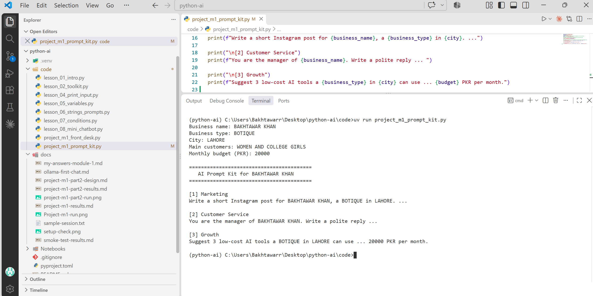

# My AI Dev Toolkit

**Name:** *BAKHTAWAR KHAN*

**Course Name:** AI for Everyone

**My AI Goal:** My goal is to learn AI engineering and build useful AI applications, chatbots, and voice agents.

## How to Run

Run the following command in the terminal:

uv run main.py


## Lessons Completed So Far

1. Introduction to Artificial Intelligence (AI)
2. Generative AI
3. Large Language Models (LLMs)
4. Difference between Chatbots, Assistants, and Agents
5. Introduction to Python
6. Python `print()` function
7. Using f-strings in Python
9. Introduction to `uv` and Python environments
10. Introduction to Ollama and local LLMs
11. Basic AI application architecture
12. Introduction to Git/GitHub and VS Code

# Folder Structure

python-ai/
├── code/             # Store Python code
├── notebooks/        # Store Jupyter notebooks
├── docs/             # Store project documentation
├── .gitignore        # Files Git should ignore
├── .python-version   # Python version for the project
├── main.py           # Main Python program
├── pyproject.toml    # Project details and dependencies
├── uv.lock           # Exact dependency versions
└── README.md         # Project information and instructions

## Module 1 Project: AI Prompt Kit

A Python tool that turns a local business's details into 3 ready-to-use AI prompts.

**Run:** `uv run code/project_m1_prompt_kit.py`



**Who would pay for this:** (one line, e.g. small shop owners who want AI help but don't know what to type)


## Business Helper Bot — Intent Design Table

| Intent | Keywords to Check | Bot Reply |
|---|---|---|
| Greeting | `hi`, `hello` | Hello! How can I help you? |
| Timings | `timing`, `hours`, `open` | We are open 10 am to 8 pm, Monday to Saturday. |
| Fees | `fee`, `price`, `cost` | Consultation fee is 2,000 PKR. |
| Location | `location`, `address`, `where` | We are located in Lahore. |
| Appointment | `appointment`, `book`, `booking` | Please call the clinic to book an appointment. |
| Complaint | `complaint`, `late`, `problem` | Sorry about that. The clinic manager will call you today. |

## Module 1 Project: Sweet Crumbs Front Desk Assistant

A beginner-friendly Python front desk bot for a bakery that answers FAQs, calculates quotes with bulk discounts and delivery fees, and prepares prompts for unanswered questions.

### Run

```bash
uv run code/project_m1_front_desk.py
```

### Screenshot

See `docs/project_m1-part2-run.png` for a sample session. Regenerate or replace it with a screenshot from your own terminal after running the script.

### Value to the owner

The bot can reduce repetitive staff replies and pricing mistakes by answering common questions instantly and calculating quotes consistently; the owner can review the session report to see what customers ask most often.


## Task 2.4 Stretch: Bot Battle
I tested 8 questions. The rules could not answer 3 of them
(dentist, Sunday, insurance). The AI answered all 8 using the clinic facts.
