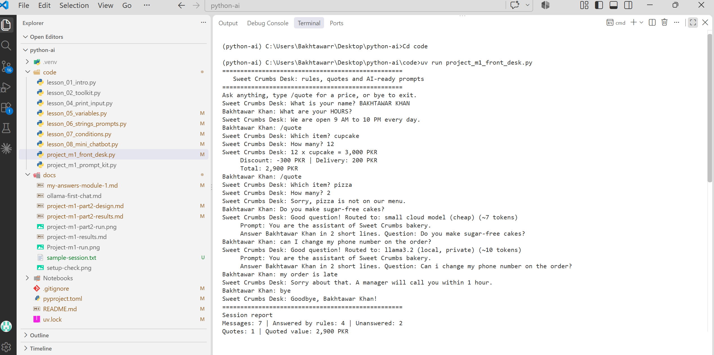
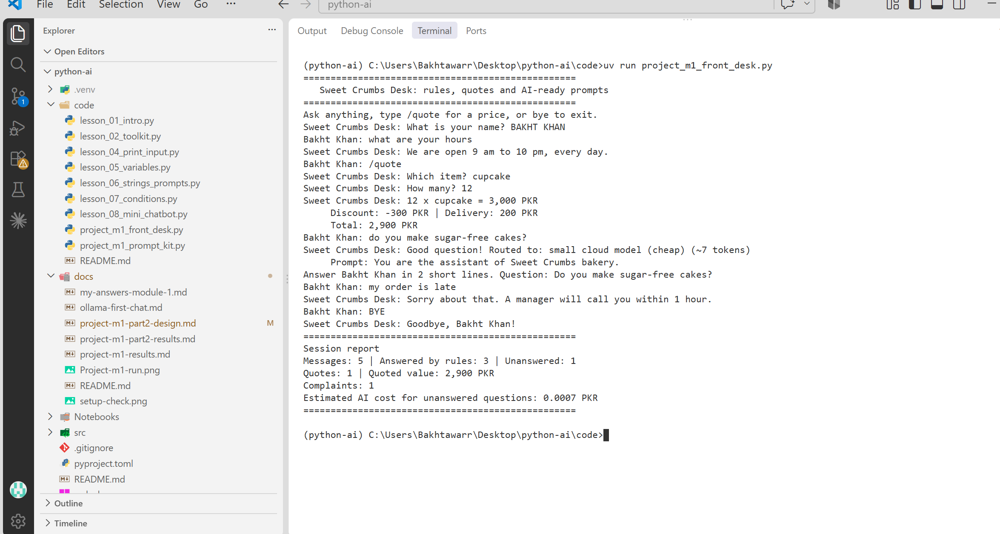

# Python for AI: Module 1

**Name:** BAKHTAWAR KHAN
**Course:** Python for AI

**My AI goal:** I want to become an AI Agent Developer and build AI tools that help local businesses save time.

## How to run

    uv run main.py

## Lessons done

- Lesson 1.1: AI career intro
- Lesson 1.2: Toolkit proof
- Lesson 1.3: Client-ready repo
- Lesson 1.4: Business prompt builder

## Module 1 Project: AI Prompt Kit

A Python tool that turns a local business's details into 3 ready-to-use AI prompts.

**Run:** `uv run code/project_m1_prompt_kit.py`

## Lesson 1.8: Business Helper Bot (City Care Clinic)

| Intent | Keywords | Reply |
|---|---|---|
| Complaint | late, complaint, problem | Sorry about that. The clinic manager will call you today. |
| Greeting | hi, hello | Hello! How can I help? |
| Timings | timing, open, time | We are open 10 am to 8 pm, Monday to Saturday. |

| Fees | fee, price, cost | Consultation fee is 2,000 PKR. |
| Location | where, location, address | We are on Main Boulevard, Lahore. |
| Appointment | appointment, book | Please call 0300-0000000 to book. |

**Run:** `uv run code/lesson_08_mini_chatbot.py`

turns unanswered questions into AI-ready prompts.

## Module 1 Project: AI Front Desk

A front desk bot for Sweet Crumbs bakery that answers FAQs with rules, quotes exact prices with discount and delivery, and turns other questions into AI-ready prompts.

**Run:** `uv run code/project_m1_front_desk.py`

**Value:** it answers repeated questions for free and quotes prices without staff mistakes, so the owner saves staff time and pays for AI only on hard questions.

